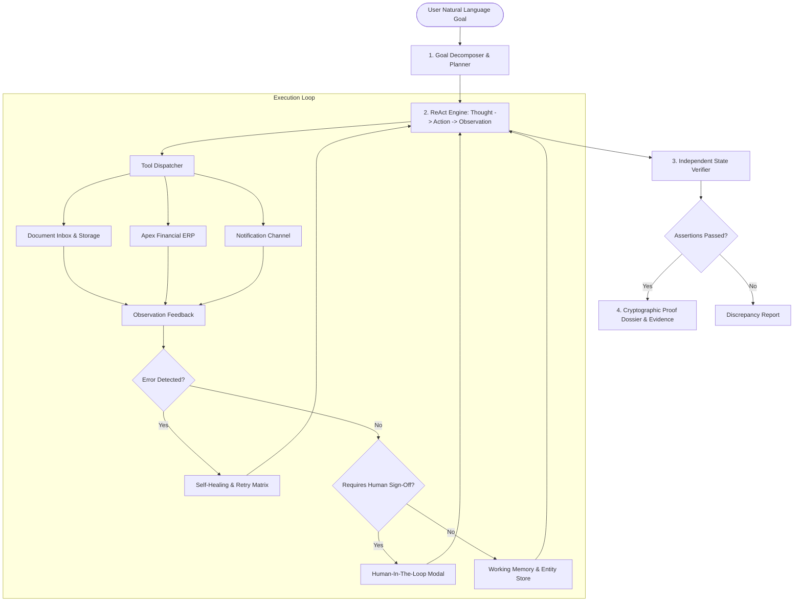

# AutoWorker Architecture Specification

## 1. System Overview & Philosophy

**AutoWorker** is an autonomous AI task agent engineered to execute end-to-end knowledge-work procedures across enterprise systems without step-by-step procedural scripting. Given an unstructured, high-level intent (e.g., *"Find the latest invoice from Acme Corp, extract the amount and due date, enter it into our internal system, and tell me once it is done"*), the worker:

1. **Decomposes** the goal into dynamic, adaptive milestones.
2. **Executes** a ReAct (Reasoning + Acting) loop utilizing simulated or real tools.
3. **Observes** the output of every action, maintaining persistent working memory.
4. **Detects Failures** and triggers self-healing strategies (e.g. data reformatting, entity disambiguation).
5. **Enforces Guardrails** via Human-in-the-Loop (HITL) checkpoints when risk/policy thresholds are reached.
6. **Verifies Outcomes Independently** through cryptographic-style post-condition state assertions.

---

## 2. Core Architectural Subsystems

### 2.1 The Autonomous Agent Loop (`src/core/agent.ts`)
The orchestrator drives a finite state machine:
`IDLE` &rarr; `PLANNING` &rarr; `RUNNING` &rarr; `WAITING_APPROVAL` (if HITL triggered) &rarr; `VERIFYING` &rarr; `COMPLETED` / `FAILED`.

At each iteration, the agent executes three tightly-coupled phases:
- **Thought Phase**: Evaluates current goal progress against working memory and error history.
- **Action Phase**: Formulates structured tool parameters and dispatches execution.
- **Observation Phase**: Ingests tool response, updates entity memory, detects anomalies.

### 2.2 Working Memory & Entity Store (`src/core/memory.ts`)
Tracks contextual facts extracted across disjoint systems:
- Discovered entities (`extractedVendor`, `canonicalVendorId`, `invoiceNumber`, `amount`, `dueDate`).
- Retry counters per action to prevent runaway loops and enable backoff logic.
- Operational audit trails for post-execution compliance.

### 2.3 Self-Healing & Error Recovery Matrix (`src/core/tools.ts`, `src/core/llm.ts`)
Real enterprise systems reject malformed data. Rather than failing immediately, AutoWorker features adaptive recovery:
- **Date Format Incompatibility**: If the ERP returns `ERROR_INVALID_DATE_FORMAT: Due date must be YYYY-MM-DD`, the agent analyzes the failure, calls `reformat_date`, and re-attempts the transaction.
- **Non-Canonical Vendor Codes**: If the user or document references `"Acme Corp"`, but the ERP strictly requires canonical ID `VEND-101`, the agent intercepts the error, queries `lookup_vendor`, and retries.
- **Implicit Term Reasoning**: If an invoice omits an explicit due date header but specifies terms like `"Net 30 days from invoice date"`, the agent computes the calendar due date using `calculate_date`.

### 2.4 Human-in-the-Loop (HITL) Guardrails (`src/core/types.ts`)
Autonomy without governance is hazardous in financial workflows. AutoWorker implements policy gates:
- **Monetary Policy Limit**: Any transaction exceeding `$5,000.00` automatically triggers an execution pause.
- **Non-Destructive Pause**: The agent preserves working memory and emits an SSE event. The human operator approves or rejects with an authorization rationale.
- **Audit Verification**: The approved token is recorded alongside the ledger entry.

### 2.5 Independent Verification Engine (`src/core/verifier.ts`)
Traditional automation checks `returnCode == 0`. AutoWorker implements true outcome verification by querying the target database post-execution:
1. `Assertion 1`: Invoice ID registered in ledger.
2. `Assertion 2`: Canonical Vendor ID matches the vendor extracted from the file.
3. `Assertion 3`: Amount in the database equals the exact document amount.
4. `Assertion 4`: Due date matches calculated or stated due date.
5. `Assertion 5`: Audit notification delivered to `#finance-ops`.
Produces a signed **Verification Signature** and **Ledger Audit Hash**.

---

## 3. The Digital Twin Simulation Environment (`src/env/`)

Rather than relying on brittle external mock servers, AutoWorker incorporates a fully-functional in-process enterprise twin:
- **Apex Financial ERP (`src/env/erp.ts`)**:
  - Validates canonical vendor codes, date formatting, duplicate protection, and authorization tokens.
  - Maintains a real-time append-only audit trail.
- **Document Inbox (`src/env/inbox.ts`)**:
  - Houses unstructured incoming vendor documents with varying complexity (standard invoices, Net 30 terms, high-value capital purchases, ambiguous date formats).
- **Communication Dispatcher (`src/env/notifications.ts`)**:
  - Dispatches simulated Slack announcements to `#finance-ops`.

---

## 4. Dual-Mode LLM Abstraction (`src/core/llm.ts`)

- **Embedded Autonomous Engine (Offline/Deterministic)**: High-reliability ReAct engine requiring zero API keys, enabling instant evaluations and deterministic CI testing.
- **Live LLM Providers (Google Gemini & OpenAI GPT-4o)**: Configurable via environment variables or UI selector for free-form general reasoning.
