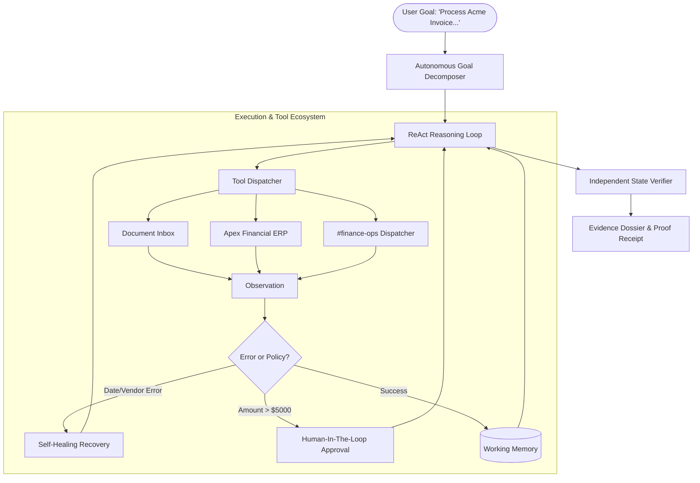

# AutoWorker: Autonomous AI Task Worker

[](https://github.com/divyadahiya14/autonomous-ai-task-worker/actions)
[](https://opensource.org/licenses/MIT)
[](https://www.typescriptlang.org/)
[](https://vitejs.dev/)
[](https://vitest.dev/)

> **A prototype autonomous AI worker that accepts high-level natural language goals, plans sequences of actions, navigates simulated enterprise systems, recovers from errors, escalates for human approval, and cryptographically proves task completion.**

---

## 🌟 Executive Summary & Problem Context

In typical corporate environments, knowledge workers routinely perform repetitive cross-application tasks: reviewing documents, extracting numbers, looking up canonical identifiers in internal portals, posting records, and notifying team channels. Today, this requires human operators to manually tab between multiple siloed applications.

**AutoWorker** demonstrates an autonomous task worker that bridges this gap. Given a goal such as:

> *"Find the latest invoice from Acme Corp, extract the amount and due date, enter it into our internal system, and tell me once it is done."*

AutoWorker autonomously figures out *what* to do, executes the appropriate tools, adapts to real-world edge cases (missing fields, format errors, high-value policy thresholds), verifies the database outcome, and delivers a verifiable audit dossier.

---

## ⚡ Core Capabilities Checklist

| Capability Requirement | Implementation in AutoWorker |
| :--- | :--- |
| **1. Goal Understanding** | Deconstructs unstructured goals into 4 dynamic milestones without procedural hard-coding. |
| **2. Action Sequencing** | Generates an adaptive plan DAG (`search_inbox` &rarr; `read_document` &rarr; `lookup_vendor` &rarr; `enter_payable` &rarr; `verify_payable` &rarr; `notify_team`). |
| **3. Real Tool Execution** | Interacts with a simulated enterprise ecosystem: Document Inbox, Apex ERP REST API, and Slack notifications. |
| **4. Observation Feedback** | Ingests structured and unstructured output after every action to guide subsequent decisions. |
| **5. Dynamic Next-Step Logic** | ReAct (Reasoning + Acting) loop evaluates observations against working memory before choosing the next action. |
| **6. Working Memory** | Tracks discovered entities (vendor names, canonical IDs, amounts, invoice numbers, tax IDs) in persistent session memory. |
| **7. Failure Detection** | Detects API errors (invalid dates, non-canonical vendor codes, duplicates, missing due dates). |
| **8. Self-Healing & Retries** | Automatically invokes date reformatter or vendor directory lookup to recover and retry failed actions. |
| **9. Outcome Verification** | An independent verifier queries the ERP ledger and communication logs to confirm live state matches source documents. |
| **10. Human-in-the-Loop (HITL)** | Pauses execution when transactions exceed `$5,000.00`, presenting an interactive approval modal to the supervisor. |
| **11. Evidence Dossier** | Generates an executive summary, assertion breakdown, and cryptographic proof receipt (`VERIFY-SIG-...`). |

---

## 🖥️ System Architecture



For complete technical specifications, see [ARCHITECTURE.md](file:///c:/Users/HP/Documents/automomous-ai/ARCHITECTURE.md).

---

## 🚀 Quickstart Guide

### Prerequisites
- **Node.js** v20+ or v22+
- **npm** v10+

### 1. Installation
Clone and install the dependencies:
```bash
git clone https://github.com/divyadahiya14/autonomous-ai-task-worker.git
cd autonomous-ai-task-worker
npm install
```

### 2. Launch the Web Studio (Interactive Dashboard)
Start the backend API server and Vite frontend:
```bash
# Terminal 1: Start backend API server (port 3001)
npm run server

# Terminal 2: Start Vite development server (port 3000)
npm run dev
```
Open **[http://localhost:3000](http://localhost:3000)** in your browser.

---

### 3. Run via CLI (Terminal Runner)
You can also run the autonomous worker directly from your command line:
```bash
npm run worker
```
Or specify a custom goal:
```bash
npm run worker -- "Process the invoice from Stark Industries, compute due date from Net 30 terms, and register it in ERP."
```

---

### 4. Run Automated Test Suite
Run the 9 automated Vitest test cases validating the core agent, self-healing matrix, and verification engine:
```bash
npm test
```

---

## 🧪 Interactive Test Scenarios & Guardrails

The AutoWorker dashboard includes 4 built-in realistic enterprise test scenarios:

### 🎯 Scenario 1: Standard Invoice Processing
- **Goal**: *"Find the latest invoice from Acme Corp, extract the amount and due date, enter it into our internal system, and tell me once it is done."*
- **What Happens**: The agent searches the inbox, reads `invoice_acme_corp_oct2026.txt`, discovers amount ($4,250.00) and due date (2026-10-31), resolves canonical vendor ID `VEND-101`, posts to Apex ERP, verifies the record, and notifies `#finance-ops`.

### ⚠️ Scenario 2: Safety Guardrails & Human-in-the-Loop (HITL)
- **Goal**: *"Process the high value hardware invoice from Cyberdyne Systems and record the payable in ERP."*
- **What Happens**: Amount is **$14,500.00**, which exceeds the automated policy threshold of **$5,000.00**. The agent safely pauses execution, emits an SSE event, and pops up an interactive **Supervisor Approval Modal**. Once approved, execution resumes with an authorization audit token.

### 🔄 Scenario 3: Autonomous Term Reasoning (Net 30)
- **Goal**: *"Process invoice from Stark Industries, compute due date from Net 30 terms, and register it in ERP."*
- **What Happens**: The invoice does not contain an explicit due date header, but states *"Terms: Net 30 days from invoice date (2026-10-05)"*. The agent notices the missing field and invokes `calculate_date` to compute `2026-11-04`.

### 🛠️ Scenario 4: Self-Healing & Error Recovery
- **Goal**: *"Locate and enter the Initech Consulting invoice into our internal accounting system."*
- **What Happens**: The date in the document is formatted in US regional style `11/12/2026`. When submitted, Apex ERP rejects it with `ERROR_INVALID_DATE_FORMAT`. The agent intercepts the error message, calls `reformat_date` to convert it to standard ISO `2026-11-12`, and retries successfully.

---

## 📂 Project Structure

```
autonomous-ai/
├── src/
│   ├── core/                      # Autonomous Agent Core
│   │   ├── types.ts               # Core interfaces (Task, ReAct, HITL, Evidence)
│   │   ├── agent.ts               # Autonomous Agent finite state machine & loop
│   │   ├── tools.ts               # Tool definitions & execution handlers
│   │   ├── memory.ts              # Working memory store & retry tracking
│   │   ├── llm.ts                 # Dual-mode LLM engine (Embedded & Live API)
│   │   ├── verifier.ts            # Independent state & outcome verification engine
│   │   └── reporter.ts            # Evidence dossier & cryptographic proof generator
│   ├── env/                       # Simulated Enterprise Digital Twin
│   │   ├── erp.ts                 # Apex ERP (Vendors, Payables, Audit Log, Validations)
│   │   ├── inbox.ts               # Document Inbox (Acme, Globex, Cyberdyne, Stark, Initech)
│   │   └── notifications.ts       # Communication Dispatcher (#finance-ops)
│   ├── server/                    # Backend API Server
│   │   └── index.ts               # Express server with Server-Sent Events (SSE) stream
│   ├── client/                    # Modern Web Dashboard (React 19 + Vite)
│   │   ├── App.tsx                # Main workbench & SSE listener
│   │   ├── components/            # Header, TaskInput, PlanView, TraceView, HitlModal, ErpTwin
│   │   └── styles/index.css       # Premium cybernetic enterprise styling
│   └── cli/                       # Command-line interface
│       └── worker-cli.ts          # Interactive CLI runner
├── tests/                         # Vitest Test Suites
│   ├── agent.test.ts              # End-to-end task flows & HITL tests
│   ├── self-healing.test.ts       # Error recovery & retry tests
│   └── verification.test.ts       # Assertion failure & tamper detection tests
├── .github/workflows/ci.yml       # GitHub Actions CI workflow
├── ARCHITECTURE.md                # In-depth architectural design document
└── package.json                   # Dependencies and scripts
```

---

## 🔗 Connecting to GitHub

To push this project to your GitHub account:

1. **Create an empty repository on GitHub**:
   Go to [github.com/new](https://github.com/new) and create a repository named `autonomous-ai-task-worker`.
   *(Do NOT initialize with a README, license, or .gitignore since they are already configured here).*

2. **Add the remote and push**:
   ```bash
   git remote add origin https://github.com/divyadahiya14/autonomous-ai-task-worker.git
   git branch -M main
   git push -u origin main
   ```

---

## 📜 License

MIT License &copy; 2026 Divya Dahiya.
